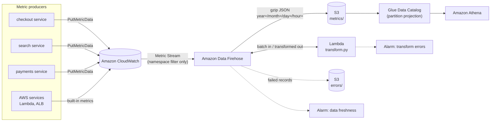
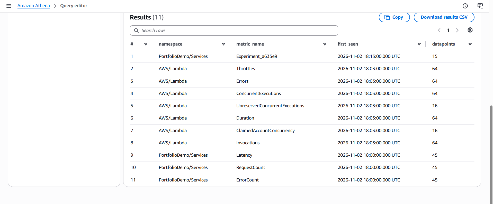
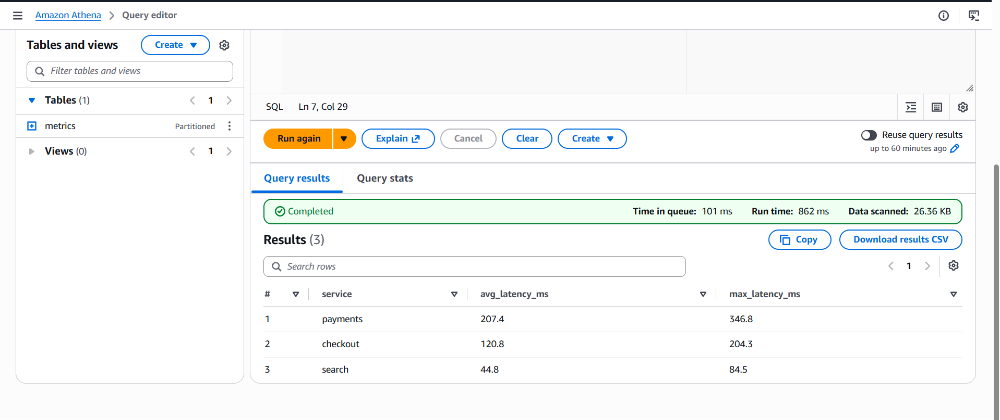
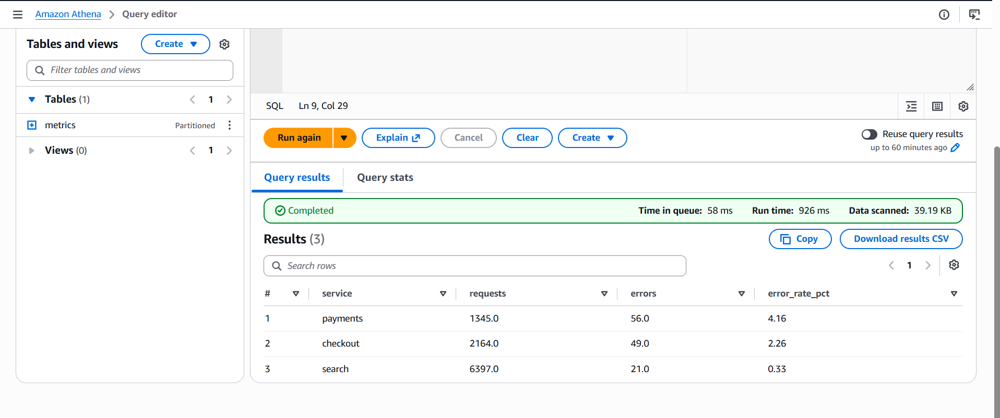
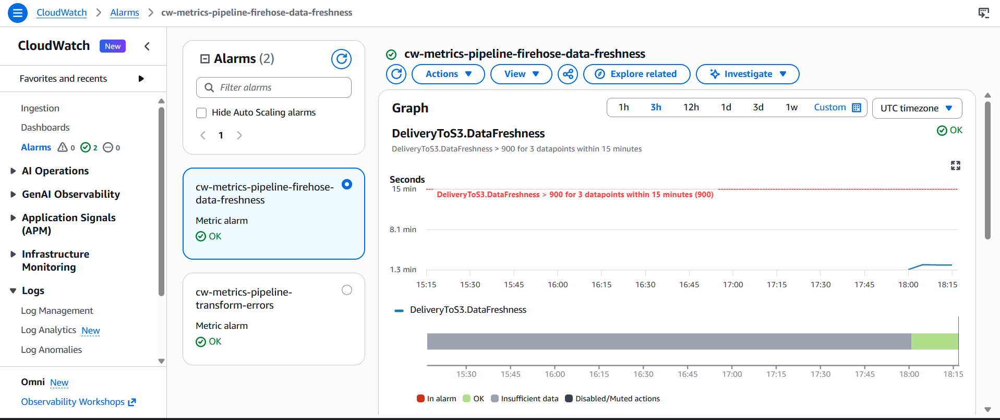

# CloudWatch Metrics → S3 Analytics Pipeline

**A serverless, zero-maintenance pipeline that continuously exports Amazon CloudWatch metrics, transforms them, and stores them in Amazon S3 for SQL analytics, automatically including new metrics with no configuration changes.**


```
CloudWatch ──► Metric Stream ──► Data Firehose ──► Lambda (transform) ──► S3 (partitioned, gzip) ──► Athena
```

---

## Table of contents

1. [The problem](#1-the-problem)
2. [The solution at a glance](#2-the-solution-at-a-glance)
3. [Architecture](#3-architecture)
4. [Design decisions and alternatives](#4-design-decisions-and-alternatives)
5. [How each component works](#5-how-each-component-works)
6. [Data model](#6-data-model)
7. [Results from a live deployment](#7-results-from-a-live-deployment)
8. [Repository layout](#8-repository-layout)
9. [Deploy it yourself](#9-deploy-it-yourself)
10. [Querying the data](#10-querying-the-data)
11. [Testing and CI](#11-testing-and-ci)
12. [Operations, security and cost](#12-operations-security-and-cost)
13. [Troubleshooting](#13-troubleshooting)
14. [Clean up](#14-clean-up)
15. [Future improvements](#15-future-improvements)
16. [What I learned](#16-what-i-learned)

---

## 1. The problem

This project is based on an AWS data-engineering scenario:

> A company operates multiple customer-facing services in one AWS account. Each service publishes performance metrics and custom application metrics to Amazon CloudWatch. A data engineering team needs to **continuously export** the metrics, **transform** the metric records, and **store** the transformed output in an Amazon S3 bucket for downstream analytics. The solution must **automatically include newly created metrics** in the CloudWatch namespace without requiring engineers to update filters or collectors each time an application adds a metric.
>
> Which solution meets these requirements with the **least operational overhead**?

There are four requirements:

| # | Requirement | Hard part |
|---|---|---|
| R1 | Continuous export | No batch jobs, no polling gaps |
| R2 | Transform records | CloudWatch's nested format is awkward to query |
| R3 | Store in S3 for analytics | Must be cheap to store *and* cheap to query |
| R4 | New metrics included automatically | Most approaches need a list of metric names |
| — | Least operational overhead | No servers, agents, cron jobs or custom collectors |

---

## 2. The solution at a glance

| Requirement | How it's met |
|---|---|
| **R1** Continuous export | **CloudWatch Metric Streams** push every metric update in near real time. Nothing polls and nothing is scheduled. |
| **R2** Transform | **Amazon Data Firehose** calls a **Lambda** function on each batch to flatten and enrich the records. |
| **R3** Store for analytics | Firehose writes **gzip-compressed, Hive-partitioned** JSON to **S3**. **Athena** queries it through a **Glue table with partition projection**. |
| **R4** Auto-include new metrics | The stream filters by **namespace only**, never by metric name, and the Lambda has no allow-list. Any new metric flows through untouched. |
| **Least overhead** | Every component is fully managed and serverless. The whole stack is one `terraform apply`. |

**Proven in a live deployment:** a metric that didn't exist when the pipeline was deployed (`Experiment_a635e9`) became queryable in Athena a few minutes after it was first published, with no pipeline changes ([details](#7-results-from-a-live-deployment)).

---

## 3. Architecture



### Data flow, step by step

1. **Producers** (application services and AWS services) publish metrics to CloudWatch, as they already do.
2. The **Metric Stream** picks up every update in the selected namespaces and pushes it to Firehose as newline-delimited JSON.
3. **Firehose** buffers incoming records for up to 60 seconds or 1 MB, then invokes the **transform Lambda**.
4. The **Lambda** flattens and enriches each metric and returns the transformed batch.
5. Firehose buffers the transformed output for up to 60 seconds or 64 MB, **gzips** it and writes it to `s3://<bucket>/metrics/year=YYYY/month=MM/day=DD/hour=HH/`.
6. Records that can't be processed go to `s3://<bucket>/errors/` so no data is lost silently.
7. **Athena** queries the data straight away. Partition projection means new hourly folders are visible with no crawler.

End-to-end latency measured in the live deployment: **about 1.3 minutes**, from Firehose ingest to an S3 object.

---

## 4. Design decisions and alternatives

### Why CloudWatch Metric Streams?

Metric Streams are the only **push-based** way to export CloudWatch metrics, and they support **namespace-level include filters**. That combination meets R1 and R4 at once. Every other option needs polling, a list of metric names, or both.

### Alternatives considered

| Alternative | Verdict | Reason |
|---|---|---|
| Scheduled Lambda / EventBridge calling `GetMetricData` + `ListMetrics` | ❌ | You'd own polling code, metric discovery, pagination, API throttling, retries and state. It's batch, not continuous. |
| Metric Stream filtered by **metric names** | ❌ | New metrics are missed silently until someone edits the filter, which breaks R4. |
| CloudWatch agent / collectors on EC2 or EMR | ❌ | Infrastructure to patch, scale and monitor. |
| Kinesis Data Streams + custom consumer | ❌ | Shards, consumer code and checkpointing, with no benefit here over Firehose. |
| CloudWatch Logs export task to S3 | ❌ | Exports logs, not metrics, as a one-off batch task. |
| **Metric Stream → Firehose (+ Lambda) → S3** | ✅ | Fully managed, continuous, namespace-scoped. Transformation is built into Firehose. |

### Other decisions

| Decision | Choice | Why |
|---|---|---|
| Output format | JSON (`output_format = "json"`) | Easy to transform in Python and readable for debugging. |
| Compression | GZIP | Cuts storage and Athena scan costs, and Athena reads `.gz` natively. |
| S3 layout | Hive-style `year=/month=/day=/hour=` | Lets Athena prune partitions so queries scan only the hours needed. |
| Schema discovery | Glue **partition projection** | No crawler, no `MSCK REPAIR`, nothing scheduled. New partitions work right away. |
| Transform failure | Per-line skip + `ProcessingFailed` | One bad line never loses a batch, and fully broken records go to `errors/` for replay. |
| IaC | Terraform | Reproducible, reviewable, and destroyable in one command. |

---

## 5. How each component works

### 5.1 CloudWatch Metric Stream (`terraform/main.tf`)

```hcl
resource "aws_cloudwatch_metric_stream" "this" {
  output_format = "json"

  dynamic "include_filter" {
    for_each = toset(var.include_namespaces)
    content {
      namespace = include_filter.value     # namespace only, no metric_names
    }
  }
}
```

The `include_filter` blocks deliberately leave out `metric_names`. That single choice is what makes the pipeline self-maintaining. Setting `include_namespaces = []` streams **every** namespace in the account and region.

Default namespaces: `PortfolioDemo/Services` (demo custom metrics), `AWS/Lambda` and `AWS/ApplicationELB`.

### 5.2 Amazon Data Firehose

- **Source:** the metric stream, which uses `firehose:PutRecord` / `PutRecordBatch`.
- **Processing:** Lambda processor, invoked with batches of up to 1 MB or every 60 s.
- **Destination:** S3 with GZIP compression, a 64 MB / 60 s buffer, and a time-based Hive prefix.
- **Error output:** `errors/!{firehose:error-output-type}/year=…/` keeps failed records apart from good data.
- **Logging:** delivery errors go to `/aws/kinesisfirehose/<name>-delivery`.

### 5.3 Transform Lambda (`lambda/transform.py`)

The function receives a Firehose batch. Each record's `data` is base64-encoded and holds one or more lines of metric-stream JSON. For every line it:

1. **Parses** the JSON.
2. **Flattens** the nested `value` object into `stat_min`, `stat_max`, `stat_sum` and `sample_count`.
3. **Computes** `stat_avg = sum / count`, leaving it null when the count is 0.
4. **Derives `service`** from the first dimension that matches `Service`, `ServiceName`, `FunctionName`, `LoadBalancer` or `ClusterName`, falling back to the namespace. This gives custom and AWS-managed metrics one shared "owner" column.
5. **Converts** the epoch-millisecond timestamp to ISO-8601 UTC (`event_time`).
6. **Collects** any extra statistics (p90, p99 and so on) into a `percentiles` map.

Each record then returns one of three results:

| Situation | Result | Effect |
|---|---|---|
| At least one line transformed | `Ok` | Transformed lines are written to `metrics/`. Bad lines are skipped and logged. |
| Content present but no line parseable | `ProcessingFailed` | The original record goes to `errors/` for inspection or replay. |
| Empty record | `Dropped` | Nothing to store. |

The function **never filters by metric name**, so it needs no change when new metrics appear.

### 5.4 Storage and analytics (`terraform/analytics.tf`)

- **S3 bucket:** public access blocked, SSE-S3 encryption, lifecycle rules.
- **Glue table `metrics`:** OpenX JSON SerDe with **partition projection** on `year`, `month`, `day` and `hour`.
- **Athena workgroup `cw-metrics-pipeline-wg`:** enforced, encrypted results location, so users don't have to configure anything.

### 5.5 Monitoring (`terraform/monitoring.tf`)

| Alarm | Metric | Fires when |
|---|---|---|
| `…-firehose-data-freshness` | `AWS/Firehose DeliveryToS3.DataFreshness` | The oldest record is more than 15 min old for 3 consecutive 5-min periods, so delivery is stuck |
| `…-transform-errors` | `AWS/Lambda Errors` | The transform Lambda errors at all in a 5-min period |

Set `alarm_sns_topic_arn` to send alarm notifications to email, Slack or PagerDuty.

---

## 6. Data model

### Input: one metric-stream record

```json
{
  "metric_stream_name": "cw-metrics-pipeline-stream",
  "account_id": "111122223333",
  "region": "us-east-1",
  "namespace": "PortfolioDemo/Services",
  "metric_name": "Latency",
  "dimensions": { "Service": "checkout" },
  "timestamp": 1793606400000,
  "value": { "max": 210.0, "min": 12.0, "sum": 1480.0, "count": 12.0, "p99": 205.5 },
  "unit": "Milliseconds"
}
```

### Output: one transformed record (real output from the live run)

```json
{
  "metric_stream_name": "cw-metrics-pipeline-stream",
  "account_id": "<redacted>",
  "region": "us-east-1",
  "namespace": "PortfolioDemo/Services",
  "metric_name": "RequestCount",
  "service": "checkout",
  "dimensions": { "Service": "checkout" },
  "unit": "Count",
  "epoch_ms": 1793642820000,
  "event_time": "2026-11-02T18:07:00.000Z",
  "stat_min": 37.0,
  "stat_max": 40.0,
  "stat_sum": 155.0,
  "sample_count": 4.0,
  "stat_avg": 38.75,
  "percentiles": {}
}
```

### Athena table schema: `cw_metrics_pipeline_db.metrics`

| Column | Type | Description |
|---|---|---|
| `metric_stream_name` | string | Stream that exported the record |
| `account_id` | string | AWS account |
| `region` | string | AWS region |
| `namespace` | string | CloudWatch namespace |
| `metric_name` | string | Metric name |
| `service` | string | Derived owner (dimension or namespace) |
| `dimensions` | map<string,string> | All original dimensions |
| `unit` | string | CloudWatch unit |
| `epoch_ms` | bigint | Timestamp in epoch milliseconds |
| `event_time` | string | ISO-8601 UTC timestamp |
| `stat_min` / `stat_max` / `stat_sum` | double | Statistics for the 1-minute period |
| `sample_count` | double | Number of samples |
| `stat_avg` | double | `stat_sum / sample_count` |
| `percentiles` | map<string,double> | Extra statistics, if configured |
| `year`, `month`, `day`, `hour` | string (partition) | UTC partition keys |

> **Tip:** to compute a correct average over many rows, use `sum(stat_sum) / sum(sample_count)`, not `avg(stat_avg)`. Averaging averages gives too much weight to periods with few samples.

---

## 7. Results from a live deployment

The pipeline was deployed to **us-east-1** on 2026-11-02. The demo traffic generator published metrics for three services for about 15 minutes.

### 7.1 Data lands continuously in S3

A new gzipped object arrived about every 60 seconds in the hourly partition, and **zero records** went to `errors/`.

```
metrics/year=2026/month=11/day=02/hour=18/cw-metrics-pipeline-delivery-1-2026-11-02-18-02-05-….gz
metrics/year=2026/month=11/day=02/hour=18/cw-metrics-pipeline-delivery-1-2026-11-02-18-03-05-….gz
metrics/year=2026/month=11/day=02/hour=18/cw-metrics-pipeline-delivery-1-2026-11-02-18-04-08-….gz
…
```


### 7.2 New metrics are included automatically (R4)

Partway through the run, `make demo-new-metric` published a metric that had never existed before: **`Experiment_a635e9`**. No pipeline component was changed.

| namespace | metric_name | first_seen (UTC) | datapoints |
|---|---|---|---|
| PortfolioDemo/Services | **Experiment_a635e9** | **18:13** | 15 |
| AWS/Lambda | Throttles | 18:03 | 64 |
| AWS/Lambda | Errors | 18:03 | 64 |
| AWS/Lambda | ConcurrentExecutions | 18:03 | 64 |
| AWS/Lambda | UnreservedConcurrentExecutions | 18:03 | 16 |
| AWS/Lambda | Duration | 18:03 | 64 |
| AWS/Lambda | ClaimedAccountConcurrency | 18:03 | 16 |
| AWS/Lambda | Invocations | 18:03 | 64 |
| PortfolioDemo/Services | Latency | 18:00 | 45 |
| PortfolioDemo/Services | RequestCount | 18:00 | 45 |
| PortfolioDemo/Services | ErrorCount | 18:00 | 45 |

The new metric appeared without any change. **Seven AWS/Lambda metrics that are named nowhere in the code or config** were picked up the same way.



### 7.3 The numbers stay accurate end to end

The demo generator draws values from known distributions. Comparing what it was told to generate with what Athena reports shows that the transform keeps the data accurate.

**Latency (avg)**

| Service | Configured | Measured in Athena | Difference |
|---|---|---|---|
| payments | 210 ms | 207.4 ms | −1.2% |
| checkout | 120 ms | 120.8 ms | +0.7% |
| search | 45 ms | 44.8 ms | −0.4% |

**Error rate**

| Service | Configured | Measured | Requests | Errors |
|---|---|---|---|---|
| payments | 4.0% | 4.16% | 1,345 | 56 |
| checkout | 2.0% | 2.26% | 2,164 | 49 |
| search | 0.5% | 0.33% | 6,397 | 21 |

The small differences are expected random variation. The search error rate is the noisiest because errors there are rare (21 errors where about 32 were expected).




### 7.4 Query cost and speed

The latency query scanned **25.87 KB** in **568 ms**. Gzip compression and partition pruning keep scans tiny, and Athena bills per byte scanned.

### 7.5 Pipeline health

Both alarms stayed **OK** for the whole run. Firehose data freshness held at **about 1.3 minutes**, well under the 15-minute threshold.



---

## 8. Repository layout

```
.
├── lambda/
│   └── transform.py                 # Firehose transformation function
├── tests/
│   ├── test_transform.py            # 8 unit tests
│   └── fixtures/
│       └── sample_metric_stream.jsonl
├── terraform/
│   ├── versions.tf                  # Terraform + provider versions
│   ├── variables.tf                 # Inputs (namespaces, buffer, alarms…)
│   ├── main.tf                      # S3, Lambda, Firehose, Metric Stream, IAM
│   ├── analytics.tf                 # Glue table + Athena workgroup
│   ├── monitoring.tf                # CloudWatch alarms
│   ├── outputs.tf
│   └── terraform.tfvars.example
├── scripts/
│   └── generate_metrics.py          # Demo traffic + new-metric proof
├── athena/
│   └── queries.sql                  # Analytics queries (run one at a time)
├── docs/                            # Screenshots from the live run
├── .github/workflows/ci.yml         # pytest + terraform fmt/validate
├── Makefile
├── requirements-dev.txt
└── README.md
```

---

## 9. Deploy it yourself

### Prerequisites

| Tool | Version | Check |
|---|---|---|
| Terraform | ≥ 1.5 | `terraform -version` |
| Python | 3.12 (3.10+ works) | `python3 --version` |
| AWS CLI | v2 | `aws --version` |
| make | any | `make --version` |

You also need an AWS identity allowed to create IAM roles and policies, S3, Lambda, Firehose, CloudWatch metric streams and alarms, Glue and Athena resources.

### Install the tools (Ubuntu/Debian)

```bash
sudo apt update && sudo apt install -y make python3 python3-pip python3-venv unzip curl

# Terraform
wget -O- https://apt.releases.hashicorp.com/gpg | sudo gpg --dearmor -o /usr/share/keyrings/hashicorp-archive-keyring.gpg
echo "deb [signed-by=/usr/share/keyrings/hashicorp-archive-keyring.gpg] https://apt.releases.hashicorp.com $(lsb_release -cs) main" \
  | sudo tee /etc/apt/sources.list.d/hashicorp.list
sudo apt update && sudo apt install -y terraform

# AWS CLI v2
curl "https://awscli.amazonaws.com/awscli-exe-linux-x86_64.zip" -o awscliv2.zip
unzip awscliv2.zip && sudo ./aws/install
```

### Step 1: Configure AWS

```bash
aws configure                  # access key, secret, region (e.g. us-east-1), output json
aws sts get-caller-identity    # confirms which account you're deploying to
```

### Step 2: Set up Python

```bash
git clone <your-repo-url> && cd <repo>
python3 -m venv .venv
source .venv/bin/activate      # repeat in every new terminal
pip install -r requirements-dev.txt
```

### Step 3: Run the tests (local, free)

```bash
make test        # expect: 8 passed
```

### Step 4: Configure (optional)

```bash
cp terraform/terraform.tfvars.example terraform/terraform.tfvars
```

| Variable | Default | Purpose |
|---|---|---|
| `aws_region` | `us-east-1` | Deployment region |
| `project_name` | `cw-metrics-pipeline` | Prefix for all resource names |
| `include_namespaces` | `["PortfolioDemo/Services","AWS/Lambda","AWS/ApplicationELB"]` | Namespaces to stream; `[]` streams all |
| `service_dimension_keys` | `["Service","ServiceName","FunctionName","LoadBalancer","ClusterName"]` | Dimension priority for deriving `service` |
| `firehose_buffer_seconds` | `60` | S3 write buffer (60–900 s) |
| `alarm_sns_topic_arn` | `""` | SNS topic for alarms (optional) |
| `force_destroy_bucket` | `true` | Allow `destroy` to delete a non-empty bucket |

### Step 5: Deploy

```bash
make deploy      # runs terraform init + apply; review the plan, type "yes"
```

Expected outputs:

```
athena_workgroup      = "cw-metrics-pipeline-wg"
bucket_name           = "cw-metrics-pipeline-<account-id>-us-east-1"
firehose_name         = "cw-metrics-pipeline-delivery"
glue_database         = "cw_metrics_pipeline_db"
metric_stream_name    = "cw-metrics-pipeline-stream"
streamed_namespaces   = ["PortfolioDemo/Services", "AWS/Lambda", "AWS/ApplicationELB"]
transform_lambda_name = "cw-metrics-pipeline-transform"
```

### Step 6: Generate traffic

```bash
make demo        # publishes Latency / RequestCount / ErrorCount for 3 services for 10 min
```

### Step 7: Verify data lands in S3

Wait about 5 minutes (stream start-up plus two 60-second buffers), then run:

```bash
aws cloudwatch get-metric-stream --name cw-metrics-pipeline-stream --query State   # "running"

BUCKET=$(terraform -chdir=terraform output -raw bucket_name)
aws s3 ls s3://$BUCKET/ --recursive | tail

# peek at transformed records
KEY=$(aws s3 ls s3://$BUCKET/metrics/ --recursive | tail -1 | awk '{print $4}')
aws s3 cp s3://$BUCKET/$KEY - | zcat | head -3
```

> Partition folders use **UTC** hours, so 21:00 in UTC+3 lands in `hour=18`.

### Step 8: Prove auto-inclusion

```bash
make demo-new-metric    # prints e.g. "Publishing NEW metric 'Experiment_a635e9'"
```

Wait about 5 minutes, then run the **new metrics** query in [section 10](#10-querying-the-data).

---

## 10. Querying the data

Open **Athena** in the deployment region, select workgroup **`cw-metrics-pipeline-wg`** (top right) and database **`cw_metrics_pipeline_db`**.

> ⚠️ The Athena editor runs **one statement at a time**. Paste each query on its own.
> Always filter on `year` / `month` / `day` so partition projection limits the scan.

**Latest rows**

```sql
SELECT namespace, metric_name, service, event_time, stat_avg, unit
FROM cw_metrics_pipeline_db.metrics
WHERE year = '2026' AND month = '11' AND day = '02'
ORDER BY epoch_ms DESC
LIMIT 20
```

**Every metric seen and when it first appeared (auto-inclusion proof)**

```sql
SELECT namespace, metric_name,
       min(from_iso8601_timestamp(event_time)) AS first_seen,
       count(*) AS datapoints
FROM cw_metrics_pipeline_db.metrics
WHERE year = '2026' AND month = '11' AND day = '02'
GROUP BY namespace, metric_name
ORDER BY first_seen DESC
```

**Latency per service**

```sql
SELECT service,
       round(sum(stat_sum) / nullif(sum(sample_count), 0), 1) AS avg_latency_ms,
       round(max(stat_max), 1) AS max_latency_ms
FROM cw_metrics_pipeline_db.metrics
WHERE metric_name = 'Latency' AND year = '2026' AND month = '11' AND day = '02'
GROUP BY service
ORDER BY avg_latency_ms DESC
```

**Error rate per service**

```sql
SELECT service,
       sum(CASE WHEN metric_name = 'RequestCount' THEN stat_sum END) AS requests,
       sum(CASE WHEN metric_name = 'ErrorCount' THEN stat_sum END) AS errors,
       round(100.0 * sum(CASE WHEN metric_name = 'ErrorCount' THEN stat_sum END)
             / nullif(sum(CASE WHEN metric_name = 'RequestCount' THEN stat_sum END), 0), 2) AS error_rate_pct
FROM cw_metrics_pipeline_db.metrics
WHERE namespace = 'PortfolioDemo/Services' AND year = '2026' AND month = '11' AND day = '02'
GROUP BY service
ORDER BY error_rate_pct DESC
```

**AWS Lambda duration by function (AWS-managed metrics in the same table)**

```sql
SELECT dimensions['FunctionName'] AS function_name,
       round(sum(stat_sum) / nullif(sum(sample_count), 0), 2) AS avg_duration_ms,
       round(max(stat_max), 2) AS max_duration_ms
FROM cw_metrics_pipeline_db.metrics
WHERE namespace = 'AWS/Lambda' AND metric_name = 'Duration'
  AND year = '2026' AND month = '11' AND day = '02'
GROUP BY 1
ORDER BY avg_duration_ms DESC
```

**Hourly trend for one service**

```sql
SELECT date_trunc('hour', from_iso8601_timestamp(event_time)) AS hour_utc,
       round(sum(stat_sum) / nullif(sum(sample_count), 0), 1) AS avg_latency_ms
FROM cw_metrics_pipeline_db.metrics
WHERE service = 'checkout' AND metric_name = 'Latency'
  AND year = '2026' AND month = '11'
GROUP BY 1
ORDER BY 1
```

---

## 11. Testing and CI

### Unit tests

```bash
make test
```

| Test | What it checks |
|---|---|
| `test_transforms_every_line_in_fixture` | Every input line produces one output line |
| `test_flattens_stats_and_derives_fields` | `service`, `stat_avg`, `event_time` and `percentiles` are correct |
| `test_new_unknown_metric_passes_through_without_config` | **R4:** an unseen metric name isn't filtered out |
| `test_aws_namespace_falls_back_to_dimension_or_namespace` | `service` derivation for AWS metrics |
| `test_zero_count_gives_null_average` | No divide-by-zero |
| `test_bad_line_is_skipped_good_lines_kept` | One bad line doesn't lose the batch |
| `test_fully_unparseable_record_goes_to_error_prefix` | Broken records go to `errors/` |
| `test_empty_record_is_dropped_and_record_ids_preserved` | Firehose `recordId` contract is honoured |

### Continuous integration

`.github/workflows/ci.yml` runs on every push and pull request:

- **python job:** installs dependencies and runs `pytest`
- **terraform job:** `terraform fmt -check`, `init -backend=false` and `validate`

### Lint locally

```bash
make lint
```

---

## 12. Operations, security and cost

### Security

- **S3:** all public access blocked, SSE-S3 encryption at rest, and the Athena results location encrypted.
- **IAM least privilege:** each service has its own role, with permissions limited to the specific resource ARNs it touches:
  - Metric stream role → `firehose:PutRecord(Batch)` on one delivery stream
  - Firehose role → S3 write on one bucket, invoke on one Lambda, logs on one log group
  - Lambda role → CloudWatch Logs only
- **Confused-deputy protection:** trust policies are scoped with `aws:SourceAccount` (metric stream) and `sts:ExternalId` (Firehose).

### Data lifecycle

| Prefix | Rule |
|---|---|
| `metrics/` | Move to S3 Standard-IA after 90 days |
| `errors/` | Expire after 30 days |
| `athena-results/` | Expire after 7 days |

### Cost

| Component | Pricing basis | Notes |
|---|---|---|
| CloudWatch Metric Streams | Per 1,000 metric updates | **Main cost driver.** Scope `include_namespaces` to what you need. |
| Data Firehose | Per GB ingested | Small for metric volumes |
| Lambda | Per request + GB-second | A few invocations per minute |
| S3 | Per GB-month + requests | Gzip keeps it small |
| Athena | Per TB scanned | KB-scale scans thanks to partitioning |
| Custom metrics (demo only) | Per custom metric per month | Prorated hourly; delete them after the demo |

Check current prices on the AWS pricing pages for CloudWatch, Firehose, Lambda, S3 and Athena. A short demo run costs very little, but **run `make destroy` when you're done**, because the metric stream bills for as long as it runs.

### Tuning

| Lever | Effect |
|---|---|
| `firehose_buffer_seconds` ↑ | Fewer, larger S3 objects and cheaper queries; data arrives later |
| `include_namespaces` narrower | Lower stream cost |
| `include_namespaces = []` | Stream everything, for maximum coverage |

---

## 13. Troubleshooting

| Symptom | Likely cause | Fix |
|---|---|---|
| `metrics/` empty right after deploy | Stream start-up plus two 60 s buffers | Wait 5–10 min. Check `aws cloudwatch get-metric-stream … --query State` shows `running`. |
| Files in `errors/` | Lambda rejected records | `aws logs tail /aws/lambda/cw-metrics-pipeline-transform --since 30m` |
| Nothing reaching Firehose | Stream role or filter issue | Check `IncomingRecords` on `AWS/Firehose` for the delivery stream |
| Athena: *"output location not set"* | Wrong workgroup selected | Switch to `cw-metrics-pipeline-wg` |
| Athena: *"Only one sql statement is allowed"* | Several queries pasted at once | Run each query on its own |
| Athena returns 0 rows | Partition filter uses local time | Partitions are **UTC**. Check the `hour=` folders in S3. |
| `make: python: not found` | venv not active | `source .venv/bin/activate` |
| `externally-managed-environment` on pip | System Python on recent Ubuntu | Use the venv (Step 2) |
| `make destroy` fails on the bucket | `force_destroy_bucket = false` | Empty the bucket first, or set the variable to `true` |

Useful commands:

```bash
aws logs tail /aws/lambda/cw-metrics-pipeline-transform --since 30m
aws logs tail /aws/kinesisfirehose/cw-metrics-pipeline-delivery --since 30m

aws cloudwatch get-metric-statistics --namespace AWS/Firehose --metric-name IncomingRecords \
  --dimensions Name=DeliveryStreamName,Value=cw-metrics-pipeline-delivery \
  --start-time $(date -u -d '-30 min' +%FT%TZ) --end-time $(date -u +%FT%TZ) \
  --period 300 --statistics Sum
```

---

## 14. Clean up

```bash
make destroy                                            # type "yes"

# verify
aws s3 ls | grep cw-metrics                             # no output
aws cloudwatch list-metric-streams --query 'Entries[].Name'   # []
```

The custom demo metrics in `PortfolioDemo/Services` can't be deleted. They expire on their own after CloudWatch's retention period and stop costing anything once nothing publishes to them.

---

## 15. Future improvements

- **Parquet output:** Firehose record-format conversion to columnar Parquet for 5–10× smaller scans.
- **Dynamic partitioning by namespace:** physical separation per team or service.
- **Percentiles:** add `statistics_configuration` to stream p90/p99 for chosen metrics.
- **Multi-account / multi-region:** CloudWatch cross-account observability feeding one central stream.
- **Dashboards:** QuickSight or Grafana (Athena data source) on top of the table.
- **Remote Terraform state:** an S3 backend with state locking for team use.
- **Replay tooling:** a script to reprocess objects from `errors/`.

---

## 16. What I learned

- **Push beats pull for telemetry export.** Metric Streams remove the whole problem of discovering, polling and throttling.
- **Filter by namespace, not by name.** Where you put the filter decides whether a pipeline maintains itself or needs constant upkeep.
- **Firehose transformation is the cheapest place to transform.** There's no extra service to run, and failures route to an error prefix automatically.
- **Partition projection removes Glue crawlers entirely** for time-partitioned data.
- **Validate with known inputs.** Generating data from known distributions and checking Athena against them (latency within about 1.2% of configured values) turned "it runs" into "it's correct."

---

## Tech stack

**AWS:** CloudWatch Metric Streams · Amazon Data Firehose · Lambda · S3 · Glue Data Catalog · Athena · IAM · CloudWatch Alarms
**Tooling:** Terraform · Python 3.12 · pytest · boto3 · GitHub Actions · Make

